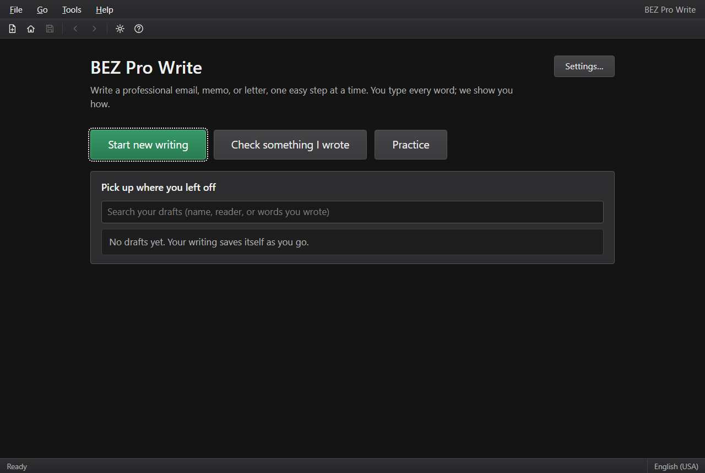

<!-- Created by: Brennan Meyer with use of Claude Code 10/30/2026 Santa Clarita, CA -->
<!-- brennanmmeyer@gmail.com -->

# BEZ Pro Write

**A step-by-step coach for professional writing. You type every word; it shows you how.**

BEZ Pro Write walks you through an email, memo, business letter, cover letter, or short report one easy screen at a time. It then checks the result against the **7 C's**: Clear, Concise, Concrete, Correct, Coherent, Complete, and Courteous. It points at spots worth a second look and explains why. It never rewrites your words.

Works fully offline on Windows and Mac. No account, no internet, no AI.



## What it does

- **Guided writing.** Pick a type and topic (Request, Apology, Complaint, Thank You, and more). Plan who you're writing to and the key facts, then write one part per screen. Each part gives you a tip, a good example, a bad example, and (for most parts) phrase ideas.
- **Writing frameworks.** STAR, BLUF, PREP, an apology formula, and SBI break harder parts into small guided boxes.
- **The 7 C's check.** Big problems first (Complete, Clear, Coherent, Courteous), then the polish (Concise, Concrete, Correct). Every flagged spot is highlighted with a color *and* a letter badge. Click one to see why and what to try instead, step through them with **F3**, or mark one "This one's fine" if you're keeping it.
- **Live scores.** Readability (0–100), a style score, word count, and reading time, all updating as you type.
- **Check something I wrote.** Paste an email or letter you wrote in another program, or open a .txt or Word file, and run the 7 C's checks on it. Mark which paragraph is your greeting, Ask, and closing, and those get checked too.
- **Practice.** Sixteen made-up situations over three levels. They fill in your plan, you write the rest, and harder levels open as you go.
- **Your progress.** See which C's are improving, which one to work on next, your style score over time, and how each kind of writing is going (Help → Your progress).
- **Earlier versions.** Look back at your writing from before your changes, see what you changed word by word, and restore it if you want.
- **Read it aloud.** Hear your writing in your computer's own voice, the way your reader will.
- **Export.** Copy, save as .txt or Word (.docx), or print / save as PDF on US Letter with 1" margins.
- **Your rules.** Turn off any check, set a readability goal per type, and add or remove words from any word list.

Press **F1** anytime for the built-in 7 C's guide.

## Install

**Windows:** run `BEZ Pro Write_<version>_x64_en-US.msi` and click **Yes** on the Windows prompt. It adds Start menu and desktop shortcuts. If a blue "Windows protected your PC" box appears (the app isn't signed with a paid certificate), click **More info → Run anyway**.

**Mac** (macOS 11 or newer, Apple Silicon or Intel):
1. Open `BEZ Pro Write_<version>_universal.dmg` and drag **BEZ Pro Write** into **Applications**.
2. **The first time only** (macOS asks because the app isn't signed with a paid Apple developer account):
   - **macOS 15 Sequoia or newer:** double-click BEZ Pro Write once and close the warning. Then open **System Settings → Privacy & Security**, scroll down, click **Open Anyway** next to BEZ Pro Write, and confirm.
   - **macOS 11–14:** in Applications, **right-click BEZ Pro Write → Open**, then click **Open** again.

   After that it opens normally.

To update, install the new version over the old one. Your drafts and settings stay put.

## Where your work is saved

- **Windows:** `%APPDATA%\BEZ Pro Write\`
- **Mac:** `~/Library/Application Support/BEZ Pro Write/`

Drafts save every few seconds, when you switch away, and when you close the window. Nothing leaves your computer.

## Keyboard

| Action | Windows | Mac |
|---|---|---|
| Next step | Ctrl+Enter | ⌘↩ |
| Back | Ctrl+Shift+Enter | ⌘⇧↩ |
| New writing | Ctrl+N | ⌘N |
| Save now | Ctrl+S | ⌘S |
| 7 C's guide | F1 | F1 |
| Next / previous spot on a 7 C's screen | F3 / Shift+F3 | F3 / ⇧F3 |
| Open a menu | Alt+F / G / T / H | ⌥F / G / T / H |

On the 7 C's screens, press Tab to move between highlights and Enter to see why one was flagged.

## Adding your own writing types

Go to **Settings → Writing types** and click **Save a copy I can edit** next to any type. That puts a JSON file in the `types` folder inside the save folder above. Change its words in any text editor and restart the app to see it. If a file has a mistake, the Home screen tells you what's wrong in plain words.

## For developers

Built with [Tauri 2](https://tauri.app) and plain TypeScript with Vite. See `CLAUDE.md` for the architecture and `docs/BUILD_BRIEF.md` for the original spec.

```bash
npm install
npm run dev        # browser preview on port 1420
npx tauri dev      # real app window
npm test           # vitest
npx tauri build    # Windows .msi
```

Mac builds come from the "Mac build" GitHub Actions workflow (`.github/workflows/mac.yml`), which runs on a `v*` tag.

## Credits

Made by Brennan Meyer, Santa Clarita, CA. Spelling and grammar by [Harper](https://writewithharper.com) (Apache-2.0). Word files are read with [mammoth](https://github.com/mwilliamson/mammoth.js) (BSD-2-Clause). Word lists adapted from [write-good](https://github.com/btford/write-good) (MIT). Full license notices are in `THIRD_PARTY_NOTICES` and on the app's About tab.

## License

BEZ Pro Write is free software under the GNU General Public License, version 3 or later (see `LICENSE`). Read it aloud's voice uses eSpeak NG (GPL-3.0) through phonemizer, and the Kokoro-82M voice model (Apache-2.0).
